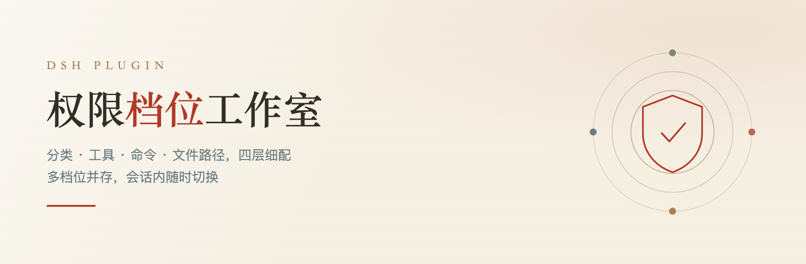
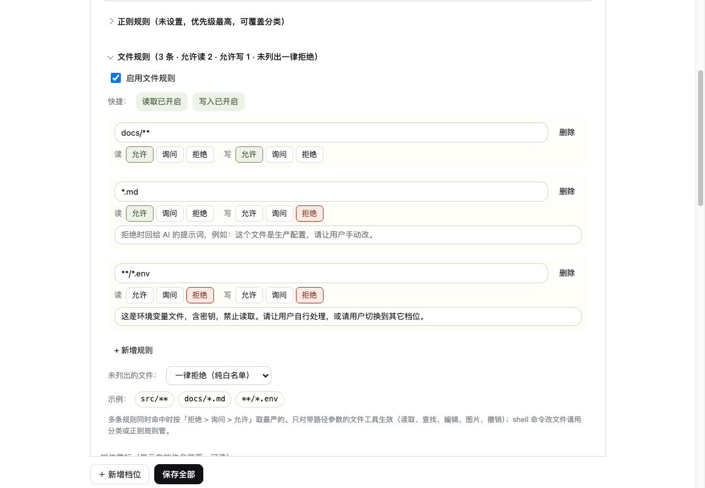
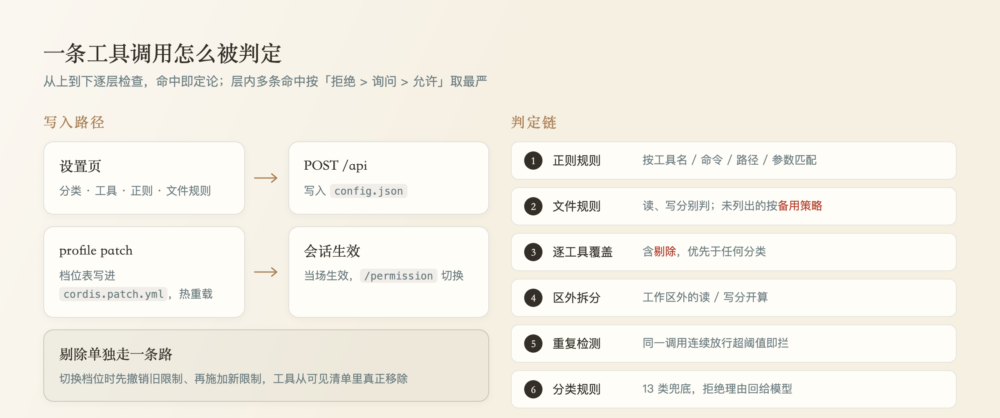
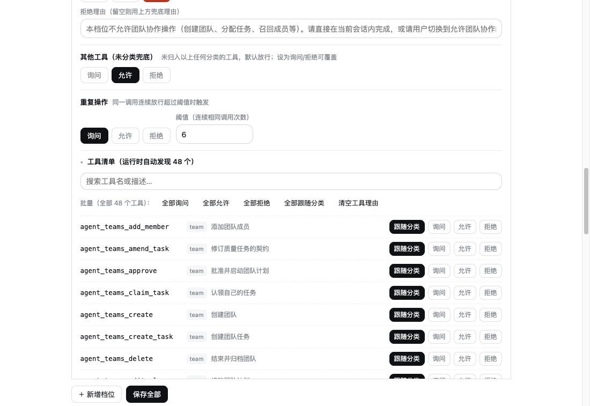
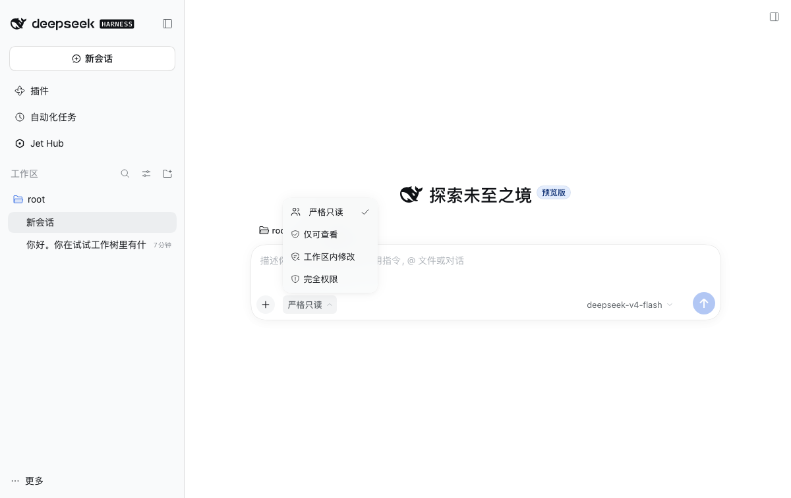

<div align="center">



# dsh-permission-studio

**A permission studio for DSH** — turn three fixed tiers into any number of independently configured presets,
switchable mid-session

Four layers of control — categories, tools, commands, file paths — where every denial can tell the model what to do instead

[](https://github.com/zcr268/dsh-permission-studio/actions/workflows/ci.yml)
[](https://github.com/zcr268/dsh-permission-studio/releases)
[](https://github.com/zcr268/dsh-permission-studio/releases/latest)
[](#development)
[](LICENSE)

[中文](README.md) · [English](README.en.md) · [Changelog](CHANGELOG.md)

</div>

---

## What this is

DSH (DeepSeek Harness) ships `@deepseek-ai/dsh-permission-presets`: any number of permission presets,
switchable mid-session with `/permission`. But the preset table can only be edited as YAML,
and its granularity stops at the **sandbox** (`read-only` / `workspace-write` / `danger-full-access`).

This plugin adds two things:

1. **A UI you can click** — add, edit and remove presets inside DSH Settings; saving takes effect immediately
2. **Finer-grained decisions** — from "sandbox on or off" down to *which kind of operation, which tool,
   which command, which file*

The point: **a denial is not a dead end, it is an explanation.** Every rule can carry a message that is
returned verbatim to the model, so it knows "this route is closed, take another" instead of retrying blindly.

<br />

<div align="center">

<br />
<sub>File rules: each pattern sets read and write independently to allow / ask / deny, with an optional message</sub>
</div>

<br />

## Four layers

| Layer | Scope | Typical use |
|---|---|---|
| **Categories** (13) | Bulk rules by operation type | "Always ask before running commands", "Never read outside the workspace" |
| **Per-tool** | One tool at a time, can be **removed** | "Make `bash` disappear from this session entirely" |
| **Regex rules** | Match tool name / command / path / arguments | "Always ask for `git push`", "Deny `rm -rf`" |
| **File rules** | By path, read and write judged separately | "Only `docs/**` is writable, `*.env` is never readable" |

Layers are checked top to bottom; the first match decides.
**Within a layer, multiple matches resolve as deny > ask > allow.**

<br />

<div align="center">

</div>

<br />

## Features

<table>
<tr><td width="50%" valign="top">

### Presets
- Any number of tiers, each with its own sandbox and approval policy
- Display name, description, default flag
- Collapsible cards showing "deny N · ask M · 13 categories" at a glance
- Optional badge shown in Settings, the native dropdown and the composer trigger

### Categories
13 operation types, each set to **ask / allow / deny**:
shell commands · file reads · file search · file edits · reads outside the workspace ·
writes outside the workspace · images · network access · undo · subagents · teams ·
other tools · repeated calls

</td><td width="50%" valign="top">

### Per-tool overrides
The tool list comes from the runtime registry (global layer plus every scoped layer),
**not a hardcoded list**. Each tool can be **follow category / ask / allow / deny / remove**.

**Remove** is not "deny at call time" — it uses DSH's `tools.restrict()` to take the tool out of this
session's visible surface, so the model never even receives its schema.
Recomputed on every preset switch: the old restriction is lifted before the new one is applied.

### Regex rules
Match by tool name, command text, path or arbitrary arguments, with the same three actions.
Higher priority than categories and per-tool overrides.

</td></tr>
</table>

### File rules: allowlist and denylist are the same thing

A rule is **path pattern + read action + write action + optional message**.

- Set it to *allow* and it is an allowlist; set it to *deny* and it is a denylist — no two separate features
- Read and write are judged independently; **write does not imply read**
- Files not listed by any rule follow a separate fallback: follow the category rules (default, cannot lock you out)
  or deny everything (a pure allowlist)
- **The fallback still applies when the list is empty**: an empty list plus "deny everything" locks everything down,
  and the denial says why
- Dedicated "enable read" / "enable write" toggles, with warnings when either is missing

### Backup and migration

The page footer has three buttons: **Export backup / Import backup / Save all**.

- Export yields one JSON containing every preset: sandbox, approval, the thirteen rule categories, per-tool
  overrides, regex rules, file rules, icons and the default preset
- Export reflects the **current page state**, so you can export unsaved edits too
- Import replaces the whole preset set; the three built-in presets are always kept, and you get a confirmation
  prompt first
- Backups carry `format` and `formatVersion`; unrelated JSON, empty files and backups from a newer version are
  rejected with an explanation

<br />

<div align="center">

<br />
<sub>Per-tool overrides: 48 tools discovered at runtime, bulk actions, removable</sub>
</div>

<br />

## Install

### Latest release (recommended)

```sh
dsh plugin --profile desktop add \
  https://github.com/zcr268/dsh-permission-studio/releases/latest/download/dsh-permission-studio.tgz
```

This URL always points at the **latest published release**. It resolves to the packaged artifact attached
to a Release, not to whatever is currently on `main` — a branch may hold half-finished work, a release does not.

### Pin a version

```sh
dsh plugin --profile desktop add \
  https://github.com/zcr268/dsh-permission-studio/releases/download/v0.2.2/dsh-permission-studio.tgz
```

### From source (development)

```sh
git clone https://github.com/zcr268/dsh-permission-studio.git
cd dsh-permission-studio
npm pack
dsh plugin --profile desktop add "$(pwd)/dsh-permission-studio-0.2.2.tgz"
```

Restart DSH; a **权限档位** (Permission presets) page appears in Settings.

### Installing from the desktop app UI

The desktop profile is owned exclusively by the Electron app, so the CLI cannot touch it — use the UI:

**Settings → Plugins → Add plugin**, and paste:

```
https://github.com/zcr268/dsh-permission-studio/releases/latest/download/dsh-permission-studio.tgz
```

That URL ends in `.tgz`, so the installer treats it as a tarball and you get the latest published release.
**Do not paste the repository URL** (`https://github.com/zcr268/dsh-permission-studio`) — that installs
from git and gives you whatever is on `main`, including unreleased commits.

> Replace `desktop` with your profile name. List profiles with `dsh profile list`.

<br />

## Usage

**Configure** → Settings → Permission presets → expand any preset

**Switch** → `/permission` in a session (no argument lists every preset)

```
/permission 只碰指定文件
```

Switching takes effect immediately, no restart. Badges follow the switch — the previous preset's icon does not linger.

<br />

<div align="center">

<br />
<sub>Badges sit exactly where DSH's own icon would; built-in presets keep their native icons</sub>
</div>

<br />

## Denial messages

Every denial can speak. Priority:

```
the rule's own message  >  the preset's fallback message  >  the category's default guidance
```

The fallback is resolved **at decision time**, not baked in when saving — change it once and every
entry that left its message blank follows immediately.

What the model receives is actionable, for example:

> This preset only allows paths listed in the file rules; `src/a.ts` is not listed.
> Current rules: `docs/**`(read:allow write:allow), `*.md`(read:allow write:deny);
> unlisted files follow "deny everything". Ask the user to adjust the file rules, or switch presets.

<br />

## Where settings live

| Content | Location |
|---|---|
| Preset table, default preset | the profile's `cordis.patch.yml` (native DSH config, hot-reloaded) |
| Category / tool / regex / file rules, badges | `$DSH_HOME/permission-studio/config.json` |

Stored separately on purpose: DSH does not know the shape of the fine-grained rules, and putting them
into the native config would fail schema validation.

<br />

## How it works

```
Settings iframe ──POST──> /permission-studio/api ──> write config ──> hot reload
                                                            │
every tool call ── tools/pre-execute (global hook) ──> decide()
        ├─ 1. regex rules (deny > ask > allow)
        ├─ 2. file rules (three actions, fallback for unlisted)
        ├─ 3. per-tool overrides (including removal)
        ├─ 4. outside-workspace read/write split
        ├─ 5. repeated-call threshold
        └─ 6. categories
```

- `deny` → returns `{ kind: 'deny', reason }`; that reason is what the model reads
- `ask` → handed back to DSH's native approval, governed by the preset's approval policy
- plugin error → fail-safe denial, never a silent allow

### Routes

| Method | Path | Purpose |
|---|---|---|
| GET | `/permission-studio/` | Self-contained page (inline HTML + CSS + JS) |
| GET | `/permission-studio/api` | Presets, default, tool catalog, category enums |
| POST | `/permission-studio/api` | Save all settings |

<br />

## Development

```sh
npm test          # 147 regression cases
npm pack          # build the tarball
```

Tests call the exported pure functions directly (`decide` / `matchFileRule` / `globToRegExp` /
`planHiddenTools` / `syncHiddenTools`); no server needed, runs in seconds.

Every bug that was fixed left a regression case behind — including a few non-obvious ones:

- `restrict` accumulates by intersection, so a preset switch must lift the old restriction or tools never come back
- Badges that are only inserted and never removed end up side by side with the native icon after a switch
- A fallback message materialized at save time stops responding to later edits
- Treating "rules exist" as a precondition makes the fallback silently inert when the list is empty

<br />

## Compatibility

Declared support (via `peerDependencies`):

| Package | Supported range |
|---|---|
| `@deepseek-ai/cordis` | `>=4.0.2 <5.0.0` |
| `@deepseek-ai/dsh-client-ui-renderer` | `0.2.0-rc.1` · `0.2.0-rc.2` · `0.2.1-rc.1` · `0.2.1-rc.2` |
| `@deepseek-ai/dsh-client-ui-settings` | same |
| `react` / `react-dom` | `^18.2.0` |
| Node.js | `^22.19.0` or `>=24.0.0` |

Host-provided packages (cordis and the client UI packages) are not reinstalled into the profile,
so those peers are marked `optional` — no missing-peer warnings on install, while the range
stays an explicit promise.

Verified: installed and started on a clean `0.2.1-rc.2` host; service self-check reports
`permissionPresets=yes tools=yes sessions=yes`, and both the Settings page and the API respond.

> Declared compatibility is not a claim that every listed version was freshly tested.
> The table is the support range; the actually verified host is noted under "Verified".

## Known limits

- **The tool list** reflects tools visible in the current process. Team members narrowed by `tool_policy`
  see fewer, but deny rules still apply to them
- **File rules** only see paths passed as tool arguments. Shell commands like `rm` or `sed -i` carry no
  reliable path — to close that, remove `bash` or deny the whole category
- **Badges** are decoration nodes inserted into the native dropdown (DSH hardcodes its icons by preset id).
  If a DSH update changes that DOM, badges may stop appearing — display only, no functional impact
- **Removal** applies from the next turn of the current round; the tool surface is sent at the start of each turn

<br />

## License

[MIT](LICENSE)

<div align="center">
<br />
<sub>Built so the model knows why it cannot</sub>
</div>
